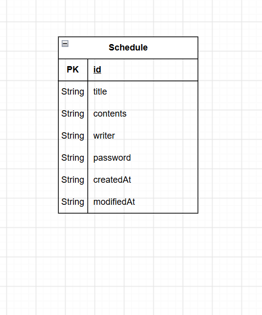

# 일정 관리 앱 API 명세서

## 공통 정보

- Base URL: `/api/schedules`
- Content-Type: `application/json`
- 인증/인가: 별도 로그인 인증 없음
- 일정 수정 및 삭제: 요청 본문에 포함된 비밀번호와 저장된 비밀번호를 비교하여 검증
- 응답 데이터: 비밀번호(`password`) 제외

---

## 1. 일정 생성

| 항목 | 내용 |
|---|---|
| API명 | 일정 생성 |
| Method | POST |
| URL | `/api/schedules` |
| 설명 | 새로운 일정을 생성한다. |

### Request

```json
{
  "title": "Spring 공부",
  "contents": "JPA와 Spring MVC 학습",
  "writer": "김개발",
  "password": "1234"
}
```

| 필드 | 타입 | 필수 | 설명 |
|---|---|---|---|
| title | String | O | 일정 제목 |
| contents | String | O | 일정 내용 |
| writer | String | O | 작성자명 |
| password | String | O | 일정 비밀번호 |

### Response

- Status: `201 Created`

```json
{
  "id": 1,
  "title": "Spring 공부",
  "contents": "JPA와 Spring MVC 학습",
  "writer": "김개발",
  "createdAt": "2026-10-12T10:00:00",
  "modifiedAt": "2026-10-12T10:00:00"
}
```

- 비밀번호는 응답에 포함하지 않는다.
- ID는 자동 생성한다.
- 최초 생성 시 작성일과 수정일은 동일하다.

---

## 2. 전체 일정 조회

| 항목 | 내용 |
|---|---|
| API명 | 전체 일정 조회 |
| Method | GET |
| URL | `/api/schedules` |
| 설명 | 전체 일정을 조회하거나 작성자명으로 필터링한다. |

### Request

작성자명 조건 없이 전체 조회:

`GET /api/schedules`

작성자명으로 조회:

`GET /api/schedules?writer=김개발`

| 파라미터 | 타입 | 필수 | 설명 |
|---|---|---|---|
| writer | String | X | 작성자명 검색 조건 |

### Response

- Status: `200 OK`

```json
[
  {
    "id": 2,
    "title": "JPA 복습",
    "contents": "Repository와 Entity 정리",
    "writer": "김개발",
    "createdAt": "2026-10-11T15:00:00",
    "modifiedAt": "2026-10-12T09:00:00"
  },
  {
    "id": 1,
    "title": "Spring 공부",
    "contents": "JPA와 Spring MVC 학습",
    "writer": "김개발",
    "createdAt": "2026-10-10T10:00:00",
    "modifiedAt": "2026-10-10T10:00:00"
  }
]
```

- 수정일(`modifiedAt`) 기준 내림차순으로 정렬한다.
- 작성자명 조건이 없으면 전체 일정을 조회한다.
- 응답에서 비밀번호는 제외한다.

---

## 3. 선택 일정 조회

| 항목 | 내용 |
|---|---|
| API명 | 일정 단건 조회 |
| Method | GET |
| URL | `/api/schedules/{id}` |
| 설명 | 일정 ID를 이용하여 특정 일정을 조회한다. |

### Request

`GET /api/schedules/1`

| 파라미터 | 타입 | 필수 | 설명 |
|---|---|---|---|
| id | Long | O | 조회할 일정의 고유 식별자 |

### Response

- Status: `200 OK`

```json
{
  "id": 1,
  "title": "Spring 공부",
  "contents": "JPA와 Spring MVC 학습",
  "writer": "김개발",
  "createdAt": "2026-10-10T10:00:00",
  "modifiedAt": "2026-10-10T10:00:00"
}
```

- 해당 ID의 일정 정보를 반환한다.
- 응답에서 비밀번호는 제외한다.
- 해당 일정이 없으면 `404 Not Found`를 반환하도록 설계한다.

---

## 4. 선택 일정 수정

| 항목 | 내용 |
|---|---|
| API명 | 일정 수정 |
| Method | PATCH |
| URL | `/api/schedules/{id}` |
| 설명 | 비밀번호가 일치하면 일정 제목과 작성자명을 수정한다. |

### Request

`PATCH /api/schedules/1`

```json
{
  "title": "Spring MVC 복습",
  "writer": "김개발",
  "password": "1234"
}
```

| 필드 | 타입 | 필수 | 설명 |
|---|---|---|---|
| id | Long | O | 수정할 일정 ID (URL 경로) |
| title | String | O | 변경할 일정 제목 |
| writer | String | O | 변경할 작성자명 |
| password | String | O | 비밀번호 검증용 |

### Response

- Status: `200 OK`

```json
{
  "id": 1,
  "title": "Spring MVC 복습",
  "contents": "JPA와 Spring MVC 학습",
  "writer": "김개발",
  "createdAt": "2026-10-10T10:00:00",
  "modifiedAt": "2026-10-12T11:00:00"
}
```

- 비밀번호가 일치할 때만 수정한다.
- 수정 가능한 필드는 제목과 작성자명으로 제한한다.
- 작성일(`createdAt`)은 변경하지 않는다.
- 수정일(`modifiedAt`)은 수정 시점으로 갱신한다.
- 응답에서 비밀번호는 제외한다.
- 비밀번호 불일치 시 `400 Bad Request`를 반환하도록 설계한다.

---

## 5. 선택 일정 삭제

| 항목 | 내용 |
|---|---|
| API명 | 일정 삭제 |
| Method | DELETE |
| URL | `/api/schedules/{id}` |
| 설명 | 비밀번호가 일치하면 해당 일정을 삭제한다. |

### Request

`DELETE /api/schedules/1`

```json
{
  "password": "1234"
}
```

| 필드 | 타입 | 필수 | 설명 |
|---|---|---|---|
| id | Long | O | 삭제할 일정 ID (URL 경로) |
| password | String | O | 비밀번호 검증용 |

### Response

- Status: `204 No Content`
- 응답 본문 없음

- 비밀번호가 일치할 때만 삭제한다.
- 비밀번호 불일치 시 `400 Bad Request`를 반환하도록 설계한다.
- 해당 일정이 없으면 `404 Not Found`를 반환하도록 설계한다.

---

## 공통 오류 응답 예시

### 존재하지 않는 일정

- Status: `404 Not Found`

```json
{
  "message": "해당 일정을 찾을 수 없습니다."
}
```

### 비밀번호 불일치

- Status: `400 Bad Request`

```json
{
  "message": "비밀번호가 일치하지 않습니다."
}
```

### 잘못된 요청

- Status: `400 Bad Request`

```json
{
  "message": "요청 데이터가 올바르지 않습니다."
}
```


